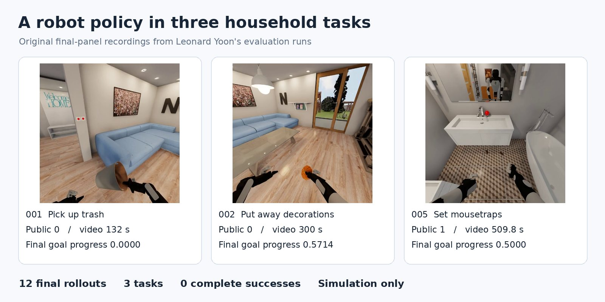
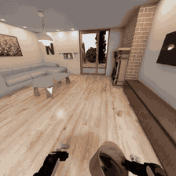
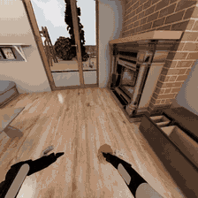
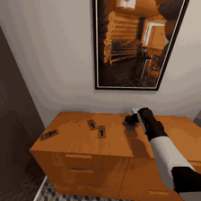
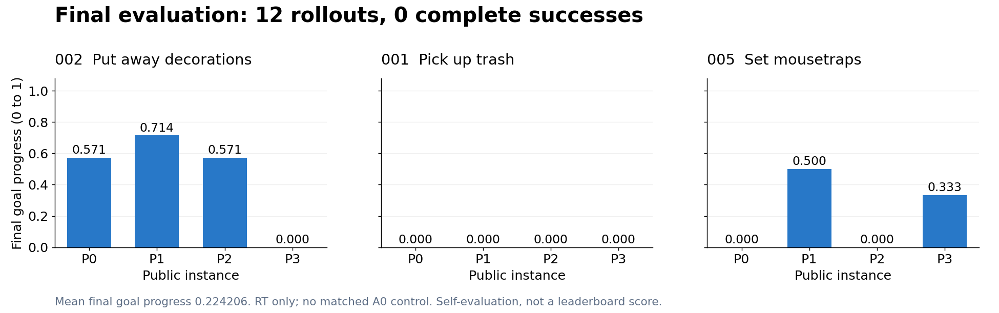
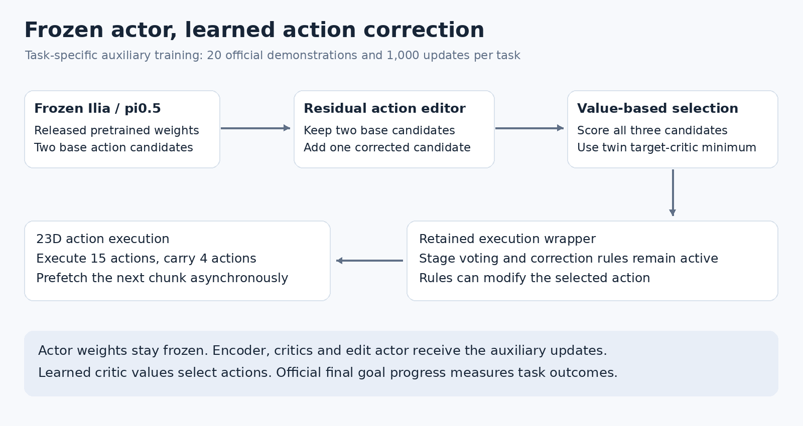
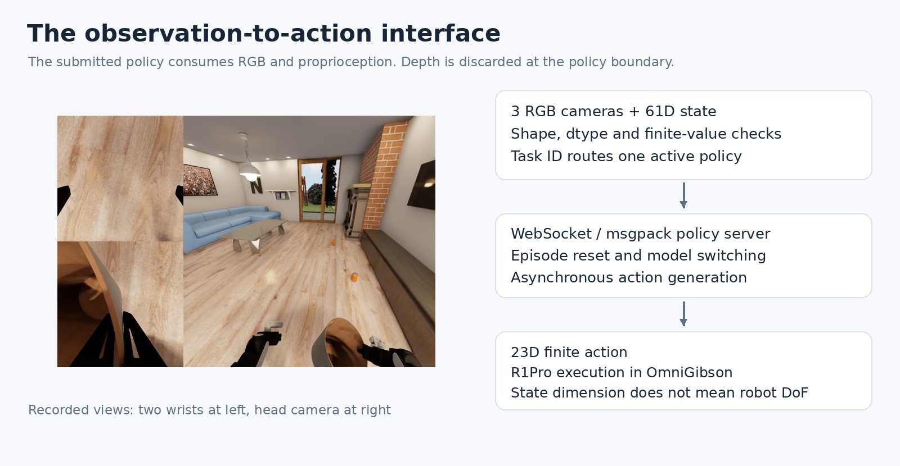
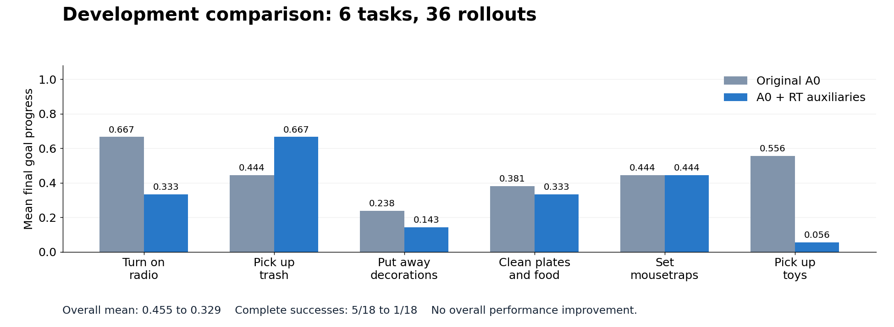
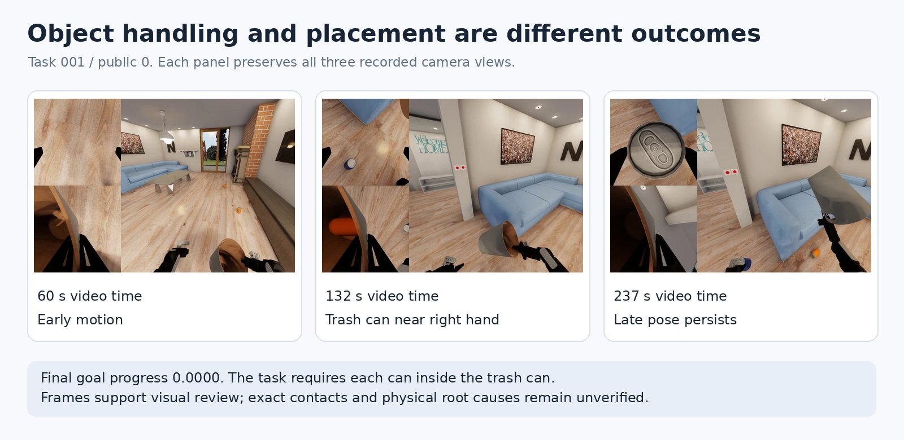
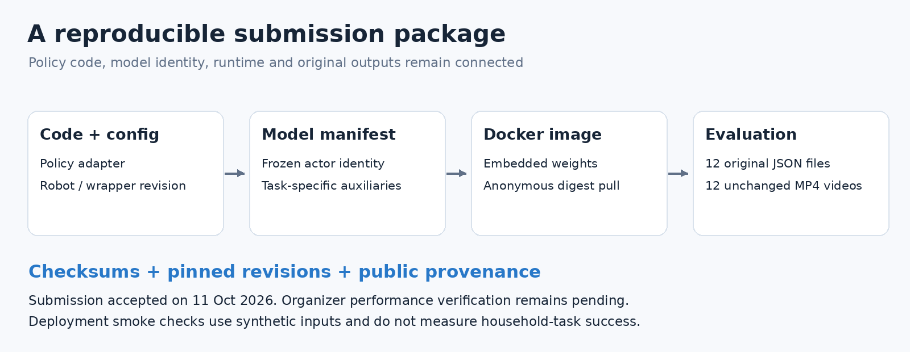

# robogoomy | BEHAVIOR 2026

**Ilia + EXPO-RT — learning small action corrections for household robots.**

Leonard Yoon · Independent researcher

Can small learned corrections help a pretrained robot policy complete household tasks? We test Ilia's released policy with EXPO-RT in simulated homes and share the results, videos, and code here.

> **Submitted October 11, 2026 · Under verification.** Portal acceptance is confirmed; organizer performance verification is pending.

[Run the policy](EVALUATION-README.md) · [Watch the rollouts](VIDEOS.md) · [Presentation](docs/reports/submission-2026/presentation-pilot6-submission12.pdf) · [Research paper](docs/reports/submission-2026/research-paper-pilot6-submission12.pdf)

[Download results](RESULTS.md) — Preview the package before downloading.

## Recorded rollouts

These previews come from my original evaluation videos. Each is a six-second head-camera excerpt, sampled at 2 FPS for a lightweight README preview. Click an image for the unchanged full video. Timestamps refer to the recorded video timeline, not inference latency or wall-clock time.

| Pick up trash | Put away decorations | Set mousetraps |
|---|---|---|
|  |  |  |
| Public 0. Final goal progress **0.0000**. | Public 0. Final goal progress **0.5714**. | Public 1. Final goal progress **0.5000**. |

Selected scenes illustrate the behavior, including incomplete tasks. All **12** original videos and checksums remain in [VIDEOS.md](VIDEOS.md). The final values above describe the whole rollout, not the displayed excerpt.

## Final results

**3 tasks · 4 public instances each · 12 rollouts.** One run per instance; all results and original videos are included.

| Task | Mean final Q | Fully completed |
|---|---:|---:|
| 002 · Put away Halloween decorations | 0.4643 | 0/4 |
| 001 · Pick up trash | 0.0000 | 0/4 |
| 005 · Set mousetraps | 0.2083 | 0/4 |

**Q is the fraction of goals satisfied at episode end.** Mean Q was **0.224206**, with partial progress but **0/12 complete successes**.

[Original result chart](docs/reports/submission-2026/submission12-status.png)

**Self-reported:** counting unsubmitted instances as zero gives **0.00269048** over the full 1,000-instance challenge. The 12-rollout mean is not the leaderboard score. [Per-instance results](results/results.csv)

## The approach

1. **Propose:** Ilia generates two action sequences.
2. **Refine:** a small network adds one edited alternative.
3. **Choose:** learned value networks select a candidate; Ilia's stage tracking and correction rules guide execution.

Ilia's weights stay frozen. Task-specific networks train on **20 official demonstrations for 1,000 updates**. [Implementation](docs/submission-2026/ILIA-RT-EXPO-INFERENCE-AUDIT.md)

## Engineering contributions

The implementation connects an existing pretrained policy and EXPO adaptation to the stock evaluator. Ilia's model architecture, released weights, stage voting and correction rules are upstream components. My work covers the adapters, task-specific auxiliary training, execution integration, evaluation and submission packaging.

| Implemented area | Inspect the code or evidence |
|---|---|
| Validate three RGB images and the 61D robot state; return a finite 23D action | [Observation/action contract](submission/contract.py) |
| Route task-specific model bundles, reset episodes, serve WebSocket/msgpack requests | [Policy factory](submission/policy.py), [server](submission/server.py) |
| Adapt native action representations and integrate value-guided selection with asynchronous execution | [Actor adapter](adapters/ilia_expo_actor.py), [inference adapter](adapters/ilia_expo_inference.py) |
| Train task-specific auxiliary networks with the base actor frozen | [Learner configuration](adapters/ilia_expo_learner.py), [inference audit](docs/submission-2026/ILIA-RT-EXPO-INFERENCE-AUDIT.md) |
| Preserve models, runtime configuration, original results and videos | [Final manifest](submission/model-manifest.final.json), [evaluation guide](EVALUATION-README.md), [results](RESULTS.md) |

The wrapper supplies RGB-D, but the final policy uses **RGB and robot state only**. The 61D state is an observation vector, not 61 robot degrees of freedom. Official demonstrations are reused; this project does not claim new human teleoperation collection or physical-robot validation.

## What we learned

In a separate **6-task, 36-rollout pilot**, adding RT to the original policy (A0) reduced mean Q from **0.455 to 0.329** and successes from **5/18 to 1/18**. RT did not improve overall performance.

The final evaluation used RT only, without a matched A0 comparison. Placement, coordination, and recovery are priorities for future investigation.

In the trash task, the final goal is that each can is **inside the trash can**. The sampled views show object handling and repeated late poses, while final goal progress remains zero. Exact contact states and the cause of failure cannot be established from these frames alone. The review combines videos, inference logs and the official goal definition, and keeps observed facts separate from hypotheses.

[Trash-picking analysis](docs/submission-2026/task001-failure-analysis/README.md) · [Instance comparison](docs/submission-2026/public3-analysis/README.md)

## Reproduce and explore

| Resource | Contents |
|---|---|
| [Evaluation guide](EVALUATION-README.md) | Docker, commands, wrapper, and robot config |
| [Policy source](submission/README.md) | Server interface and task routing |
| [Hugging Face archive](https://huggingface.co/leonayoon/behavior-submission-task001-002-005-public0-3-2026) | Results, videos, image archive, and reports |
| [Video index](VIDEOS.md) | 12 original videos and checksums |
| [Visual evidence and provenance](docs/assets/experiment-gallery-20261027/README.md) | Frame sources, video excerpts, chart data and reproduction script |
| [Research draft](docs/reports/submission-2026/research-paper-pilot6-submission12.pdf) · [LaTeX](docs/reports/submission-2026/research-paper-pilot6-submission12.tex) | Method and analysis; not published to arXiv |

Docker includes the weights; no Hugging Face token is needed. The simulator runs separately. L40S deployment checks passed; **actual 24GB hardware remains untested**.

Evaluation scope and provenance

- Final order: 002, 001, 005; public indices 0–3, one rollout each.
- Image routes: 000, 001, 002, 003, 005. Task 007 was pilot-only.
- Public index 0 had development exposure; it is not an untouched test.
- Pilot results are separate. No statistical significance claim is made.
- Official Q differs from critic predictions. Intermediate Q maxima and complete goal traces were not captured.
- The three-task, 30-instance mean, including missing zeros, is 0.089683.
- Original results and videos remain unchanged; revisions and SHA256 checksums preserve their identities.
- Submission ID: `20261011T111517Z-robogoomy-ilia-expo-rt`.

