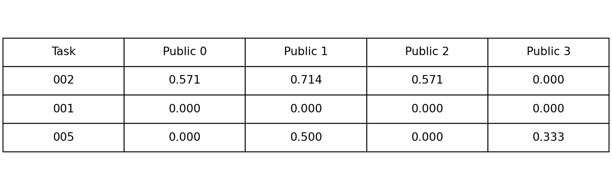
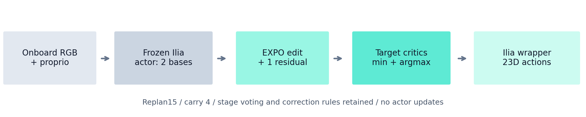
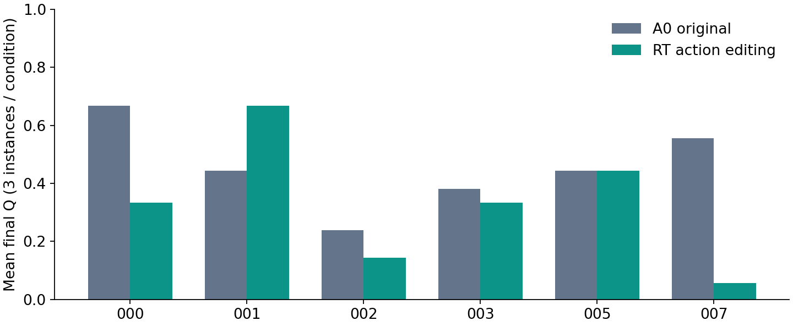

# robogoomy · Ilia + EXPO-RT

> Submitted October 11, 2026. Team **robogoomy** · **Ilia + EXPO-RT**. Leaderboard status: **Under verification**. Submission ID: `20261011T111517Z-robogoomy-ilia-expo-rt`. Receipt confirms acceptance; organizer performance verification is pending.

**BEHAVIOR-1K 2026 | Leonard Yoon | Independent**

- **Goal:** evaluate a frozen household-manipulation policy with small task-specific action edits.
- **Final scope:** 3 tasks × 4 public instances × 1 rollout = **12 rollouts**.
- **Evaluation order:** 002 → 001 → 005; public indices 0–3.
- **Status:** all 12 final rollouts completed and backed up; portal acceptance is recorded separately.

## Start here

- [Evaluation README](EVALUATION-README.md): image, setup, full evaluator command, exact wrapper and robot.
- [Final result ZIP](https://huggingface.co/leonayoon/behavior-submission-task001-002-005-public0-3-2026/resolve/main/package/submission12-final.zip?download=true): 12 original metric JSON files and reproducibility files.
- [Video index](VIDEOS.md) / [HF video index](https://huggingface.co/leonayoon/behavior-submission-task001-002-005-public0-3-2026/blob/main/VIDEOS.md): all 12 original MP4 downloads and checksums.
- [Public HF storage](https://huggingface.co/leonayoon/behavior-submission-task001-002-005-public0-3-2026): results, videos, model image archive, and reports.

## Final results

| Task | Public 0 | Public 1 | Public 2 | Public 3 | Mean final Q |
|---|---:|---:|---:|---:|---:|
| 002 | 0.5714 | 0.7143 | 0.5714 | 0.0000 | 0.4643 |
| 001 | 0.0000 | 0.0000 | 0.0000 | 0.0000 | 0.0000 |
| 005 | 0.0000 | 0.5000 | 0.0000 | 0.3333 | 0.2083 |

- **Final Q:** proportion of goal conditions satisfied at episode end; higher is better.
- **Observed 12-rollout mean Q:** 0.224206.
- **Full success:** 0/12. Partial goal progress does not mean complete task success.
- **Missing instances count as zero:** selected 3-task/30-instance mean 0.089683; full 100-task/1000-instance mean 0.00269048.
- **No cherry-picking:** all final failures and videos are included unchanged.
- These are self-reported values; the observed-panel mean is not the full leaderboard score.

## How the policy works

- **Frozen actor:** original released Ilia checkpoint 1 or 2; actor weights are unchanged during EXPO adaptation.
- **Auxiliary adaptation:** 20 official demos per task, 1,000 updates, batch size 8.
- **Candidate selection:** two actor proposals plus one small residual edit; target critics choose a candidate.
- **Real-time execution:** execute 15 actions, carry 4; retain native stage voting and correction rules.
- **Supported image routes:** 000, 001, 002, 003, 005. Only 001, 002, 005 contribute final self-evaluation outputs.

## Development pilot

- **Separate panel:** 6 tasks × 3 development instances × A0/RT = 36 rollouts.
- **Tasks:** 000 radio; 001 trash; 002 Halloween decorations; 003 plates/food; 005 mousetraps; 007 toys.
- **Overall outcome:** mean final Q 0.455 → 0.329; full success 5/18 → 1/18.
- The pilot does not establish a general RT advantage. It is not mixed into the final 12-result ZIP.

## Run and inspect

- **Policy image:** `ghcr.io/leonyoon-3dai/behavior-submission-2026:submission12-20261011`. Use the digest-pinned command in the [evaluation README](EVALUATION-README.md).
- Embedded weights; no external model mount or HF token required.
- Simulator runs outside the policy image; one GPU and one evaluator connection per policy server.
- Current L40S deployment check passed: 5 routes, seeded reset, route switching; peak memory 7,317 MiB.
- A real 24GB GPU test was intentionally skipped. L40S measurements do not prove actual 24GB support.

## Research documents

- [Presentation PDF](docs/reports/submission-2026/presentation-pilot6-submission12.pdf): visual overview, method, pilot, final results, deployment, limitations.
- [Research manuscript draft](docs/reports/submission-2026/research-paper-pilot6-submission12.pdf) / [LaTeX source](docs/reports/submission-2026/research-paper-pilot6-submission12.tex): evidence and reproducibility; not published to arXiv.
- [Inference audit](docs/submission-2026/ILIA-RT-EXPO-INFERENCE-AUDIT.md): retained Ilia components, online EXPO path, trained versus invoked networks, historical F1 distinction.
- [Task001 video analysis](docs/submission-2026/task001-failure-analysis/README.md): placement/recovery observations.
- [Public3 comparison](docs/submission-2026/public3-analysis/README.md): instance-specific evidence and limits.

## Interpretation and provenance

- Public index 0 had prior development exposure; it is not described as an untouched test.
- Final evaluation is RT-only: no matched final A0 control, significance, or generalization claim.
- Original metric/video bytes and filenames are preserved; pinned revisions and SHA256 record submission-time identities.
- Intermediate official Qmax and complete goal traces were not captured; critic Q is a different quantity.
- Additional research rollouts are deferred. Future F1+RT is a research note, not this submitted policy.
- Further editorial updates to these research documents are deferred until after submission.
