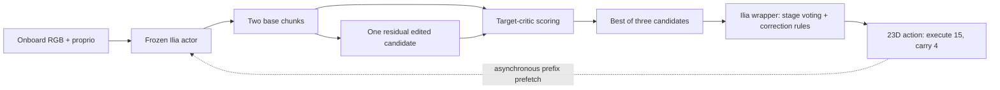

# Inference audit: frozen Ilia actor + EXPO-RT

- **Team:** robogoomy — Leonard Yoon, Independent.
- **Audited:** repository history, frozen manifests, preserved parameters, inference logs, and upstream code inside the evaluated runtime image.
- **Scope:** describe the policy used for the final 12-rollout panel. This audit introduces no policy changes or additional rollouts.
- **Key finding:** the original Ilia actor is frozen. EXPO adaptation trains auxiliary networks; it does not fine-tune the final actor.

## At a glance

- The online system retains Ilia's vision/language backbone, action expert, stage predictor, task embeddings, cross-layer KV transforms, correlated sampling, and wrapper behavior.
- Stage voting concerns **stage progression**. It is separate from critic-based **action candidate selection**.
- An edited candidate can be selected and then modified by the retained correction rules.
- The current final actor is the released original **A0**, not the separately adapted historical **F1** actor.

## Components retained from Ilia

| Component | Final behavior | Evidence / interpretation |
|---|---|---|
| PaliGemma VLM and action expert | Retained, frozen | Native `create_trained_policy` and `model.sample_actions` |
| Task embeddings and task/stage fusion | Retained, frozen | Task ID and current stage enter prompt tokens |
| VLM stage predictor | Retained, frozen | Selected base candidate supplies `subtask_logits` |
| Cross-layer KV transformation | Retained, frozen | Runtime `use_kv_transform=True` |
| Correlated noise / action correlation matrix | Retained | Native sampler; explicit training noise uses a Cholesky transform |
| Delta actions and per-time normalization | Retained | Native-to-physical-to-critic conversion, decoding, anchor rebasing |
| Rolling inpainting | Retained with RT scheduling | Four-action prefix conditions asynchronous next-chunk inference |
| Stage voting | Retained | History length 3; two votes promote to the next stage |
| Correction / evaluation rules | Enabled | `apply_eval_tricks=True`, applied after RT selection and editing |
| Original action compression | Disabled in RT | Original A0: 26/4/20; RT: 15/4/15; `should_compress=False` |
| Gripper-dependent compression exception | No active effect in RT | Compression is already disabled |
| FAST auxiliary token branch | Training only | Native action sampling does not accept FAST tokens; learned effects remain in actor weights |
| Original four-checkpoint task switcher | Selected routes only | Final five-route image uses checkpoint 1 or 2; it is not the entire upstream task system |

## Online candidate path

1. **Sample:** the frozen native actor generates two 30-step candidates. The native padded action dimension is 32; the physical executed action dimension is 23.
2. **Prefetch:** when four actions remain, a background worker generates the next candidates using that prefix. At the execution boundary, the candidate is rebased using the latest observation and anchor.
3. **Window:** select the 15-step execution window after the four-action delay. The EXPO encoder processes the three RGB cameras; critic state is built in its documented frame.
4. **Edit:** the edit actor adds one residual candidate to the first base proposal. One edit step, normalized edit scale 0.01, `edit_action_xyzg=False`: the edit is not restricted to XYZ/gripper dimensions.
5. **Score:** use the minimum of the two target-critic outputs for each candidate, then choose the maximum score among two base candidates and one edited candidate. This is not action averaging or majority voting.
6. **Return:** decode the selected 15 actions plus four carry actions from the corresponding base candidate. When the edited candidate wins, its stage logits still come from that base candidate.
7. **Execute:** the retained wrapper applies stage voting and correction rules, then executes 15 actions. Correction rules can overwrite the selected chunk.

**Timing and score interpretation**

- `learned_Q_values` are learned critic predictions, not official final goal progress.
- The four-action / 30 Hz prefix budget is approximately 0.133 seconds. A logged `slow_seconds` near 0.15 misses this internal budget.
- That internal check is different from the official average 1 FPS rollout rule, which includes simulator, communication, and inference. It does not independently establish episode-level compliance.

## Training versus online use

- Final adaptation: `train_base_actor=False`; actor initial/final hashes are asserted equal.
- Per task: 20 official demonstration episodes, batch size 8, 1,000 auxiliary updates; the sampling audit records 8,000 draws across 20 episodes.
- Each supported task has independently trained auxiliary parameters. Another task's auxiliary network was not reused unchanged.

| Network | Training / update | Direct online role |
|---|---|---|
| Critic | Gradient updates | Fast selection directly evaluates the target critic |
| Target critic | EMA from critic, tau 0.005 | Scores all three action candidates |
| Batch encoder | Trained, `freeze_critic_encoder=False` | RGB features for critic/editing |
| Edit actor | Trained | Generates the residual candidate |
| Filter critic | Trained; filters noise candidates during training | **Not called by the current `sample_pre_cache` / `fast_select` path** |
| Temperature | Trained edit-entropy coefficient | Not directly used by online fast selection; influences learned edit parameters |
| Ilia actor, stage/KV/task heads | No update during final RT adaptation | Frozen native action and stage inference |

- `freeze_encoder=True` does not imply every encoder is frozen: the separate EXPO batch encoder is trained.
- Parameter restoration does not prove online invocation. The inference NPZ restores filter/temperature parameters even though this fast path does not directly use them.
- Per-task parameter leaf counts: critic 10; target critic 10; filter critic 10; encoder 34; edit actor 12; temperature 1.

## Correction-rule limits

- Tasks 001, 002, and 005 appear in the upstream always-open task lists for both hands.
- The rule triggers only when the current normalized gripper state is below -0.98; it does **not** open a hand on every step unconditionally.
- On triggering, the rule fills the chunk with the current state and sets the affected gripper to 1.0.
- The preserved inference log does not record trigger counts, complete gripper trajectories, or actual stage transitions. The rule therefore cannot be established as the cause of task 001 failure.
- Candidate scores alone do not fully describe the final actions after wrapper postprocessing.

## Final checkpoints and historical F1 distinction

| Route | Actor | Final-panel role |
|---|---|---|
| 000 | Released checkpoint 2 | Included in frozen image; no final rollout submitted |
| 001 | Released checkpoint 2 | Four original final rollouts |
| 002 | Released checkpoint 1 | Four original final rollouts |
| 003 | Released checkpoint 1 | Included in frozen image; no final rollout submitted |
| 005 | Released checkpoint 1 | Four original final rollouts |
| 007 | Pilot only | Excluded from final image and final panel |

- Earlier research included **F1 + RT-EXPO-FT**. RT froze that F1 actor, but F1 had already undergone separate actor adaptation.
- The final policy uses original checkpoint 1/2 **A0 + task-specific RT auxiliaries**, not that historical F1 configuration.
- The proposal to additionally train the actor on 20 demonstrations was deferred by the participant and was not executed for this submission.
- Future F1 + RT analysis should compare A0, A0+RT, F1, and F1+RT under matched settings; do not assume auxiliaries transfer unchanged to a different actor.

## Deployment evidence and reproducibility

- Final embedded image: `sha256:3098b31a4a6b222bc4a1f23f879da6a72b54bc15d5cc89183b2fff99c413cf4e`.
- Same 68 verified model files and frozen manifest; storage layers were split only to meet GHCR limits.
- Policy-only deployment check: five routes plus a return to task 002, 35 finite actions per visit, seeded reset reproduction, no external model volume or HF token.
- Peak memory on the current L40S: **7,317 MiB**. Added physical rollouts: **0**.
- Synthetic input tests deployment; it does not measure household-task success. Actual 24GB hardware validation was deliberately skipped.

## Sources

- [Policy factory](../../submission/policy.py), [native actor adapter](../../adapters/ilia_expo_actor.py), [RT inference](../../adapters/ilia_expo_inference.py), [learner configuration](../../adapters/ilia_expo_learner.py), [frozen manifest](../../submission/model-manifest.final.json).
- [Original Ilia implementation](https://github.com/IliaLarchenko/behavior-1k-solution) and [released actor weights](https://huggingface.co/IliaLarchenko/behavior_submission), Apache-2.0.
- Preserved research history: commits `2478abe` and `3cb3dae`; the earlier F1 training report records actor updates 0 during its RT phase and auxiliary updates 1,000. Historical training/draw audits remain in the private preparation records, separate from public final results.
- [Evaluation README](../../EVALUATION-README.md), [original final-result panel](../../results/results.json), [all original videos](../../VIDEOS.md).
