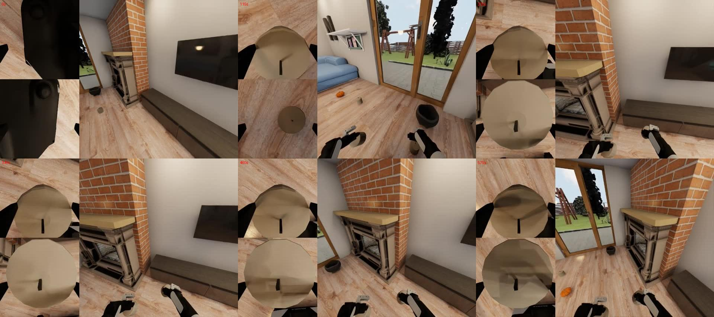

# Public instance 3: failure comparison

Read-only review of completed videos, original metrics, and inference logs on October 11, 2026. No extra rollouts or policy changes were made. Six sampled video frames cannot establish object states throughout an episode.

**Historical analysis:** some comparisons below were incomplete at the time of review. All 12 final rollouts are now complete; see [final results](../../../README.md#final-results).

## Measured results

|Task002 public instance|Final Q|Steps|Inference log entries|Elapsed time (min)|Base travel (m)|Median slow inference (s)|
|---|---:|---:|---:|---:|---:|---:|
|0|0.5714|20683|1379|335.05|28.35|0.1513|
|1|0.7143|20683|1379|321.19|29.61|0.1523|
|2|0.5714|20683|1379|335.72|24.08|0.1548|
|3|0.0000|20683|1379|274.09|11.14|0.1518|

**Task002 public3 ran the full step budget.** It recorded the same number of inference calls and similar median inference time as the other instances. Its shorter runtime is not explained by early termination or missing steps. Base and hand travel were lower. Motion, contact, or scene differences may have changed simulation cost, but the logs do not establish a cause. No evidence of a GPU3 failure was found.

Task001 public3 ran from 06:28:40 to 08:16:05 UTC (107.40 min), starting before the other Task001 instances. Recent FPS measurements were comparable to other tasks. It completed 7902 steps and 527 inference log entries with final Q 0.0. Public0–2 were unfinished **at the time of this analysis**; their completed comparison is in the [Task001 review](../task001-failure-analysis/README.md).

## What the video samples show

|Run|Observation|Possible explanation—not confirmed|
|---|---|---|
|Task002 public3|Initial scene appears normal. At about 230–575 s of simulation time, large bright objects are close to both wrist cameras; the head camera mainly faces the TV/fireplace.|Stalling during transport or placement, with blocked wrist views. Samples do not establish object identity or all goal states.|
|Task002 public0|Samples show a pumpkin grasp followed by actions toward other objects or locations. Final official Q: 0.5714.|Some goal progress, without complete task success.|
|Task001 public3|A trash can appears near the right hand at about 44 s. A similar holding posture repeats at about 88–220 s; a can is close to the left wrist after about 132 s.|Stalling during insertion/release after grasping both objects. Full-video and final-state analysis are needed to confirm this.|

Grasping a can and putting it inside the trash can are different stages. **Official Q measures the fraction of BDDL goal predicates satisfied at episode end.** Final Q 0 does not prove that Q stayed at 0 throughout the rollout. Internal `learned_Q_values` are critic predictions, not official Q.

- [Official evaluation documentation](https://behavior.stanford.edu/challenge/evaluation.html)
- [Task002 public3 samples](task002-public3-detail.jpg)
- [Task002 public0 samples](task002-public0.jpg)
- [Task001 public3 samples](task001-public3-detail.jpg)

Original videos and JSON files are preserved under each `trial/raw` directory in `outputs/clean-self-eval-20261011` and backed up unchanged to Hugging Face. The completed 12-rollout set is retained for analysis; this review does not trigger re-evaluation.
