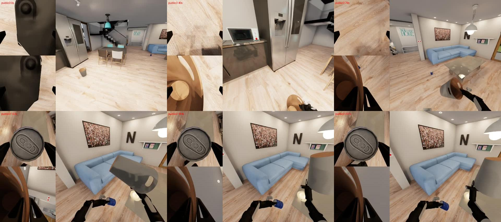

# Task001: picking up trash

Failure review of public instances 0–3, October 11, 2026. Original videos, JSON files, and inference logs were inspected without extra evaluation or changes to the frozen RT-EXPO policy. Video samples are at **0/40/79/132/184/237 seconds of simulation time**, not wall-clock time. See [final submission results](../../../README.md#final-results).

## Main finding

**The robot handles the objects but does not complete the placement goal.** All four instances show repeated mid-to-late poses with objects close to both hands. A likely bottleneck is coordinating the hands and trash-can orientation during insertion, then moving to the next action.

The goal requires `inside(can, ashcan)` for each of three cans. Grasping alone earns no credit; release is not a separate goal predicate. The actual condition is whether the can is inside the trash can. Video samples cannot confirm exact grasp attachment, collisions, 3D positions, or moment-by-moment goal states.

|Public instance|Official Q|Steps|Inference intervals|Base/left/right travel (m)|Median slow inference (s)|
|---|---:|---:|---:|---|---:|
|0|0|7902|527|12.27 /21.72 /20.71|0.1521|
|1|0|7902|527|5.09 /10.29 /10.89|0.1525|
|2|0|7902|527|8.17 /16.32 /17.75|0.1565|
|3|0|7902|527|6.15 /11.13 /12.86|0.1513|

## Comparing the instances

|Instance|Observed sequence|Interpretation|
|---|---|---|
|public0|Extensive early movement. Trash can near the right hand at 79–132 s; blue can fills the left wrist view at 184 s. Similar head-camera views near the sofa and a tilted trash can at 184–237 s.|Most movement, but no final `inside` goals achieved.|
|public1|Trash can near the right hand at 40 s; can in the left wrist view after 79 s. Similar viewpoints and holding poses at 132–237 s.|Lowest travel suggests mid-to-late stalling.|
|public2|Trash can near the right hand at 79 s; orange can in the left wrist view after 132 s. Objects remain close to both hands at 184–237 s.|The can may not align with the trash-can opening.|
|public3|Trash can near the right hand and blue can near the left wrist recur in later samples.|A shared failure pattern, rather than evidence of an instance-specific fault.|

Compare all samples: [public0](public0.jpg), [public1](public1.jpg), [public2](public2.jpg), [public3](public3.jpg).

## What the logs establish

- All runs completed the full **7902 steps** and **527 inference log entries**, ending at the normal time limit. No reconnect- or Traceback-related interruption was found.
- All used the same frozen manifest SHA and `task_name=picking_up_trash`. Inference times were similar and within the observed normal range.
- At the time of analysis, simulator CPU quotas were **11** for instances 0/2 and **10.5** for instances 1/3. These are resource ceilings, not dedicated cores. Both groups failed, so these runs do not show that extra CPU capacity resolves the failure.
- Every run logged grasp-constraint warnings about `disjointed body transforms`. These could indicate a grasp-physics mismatch, but similar warnings also occur in other tasks with partial success. The warning alone does not establish a bug or root cause.
- RT edited candidates were selected **25.0–27.1%** of the time. Critic predictions are not official Q, and actual `inside` outcomes for alternative candidates were not recorded. These logs cannot isolate critic misranking as the cause.

**Open hypotheses:** insufficient insertion behavior in the base actor; poor candidate selection by the critic/edit policy; occlusion or collisions while holding the trash can; and failure to recover from a stalled pose. There is no A0 control on the same instances, so the failure cannot be attributed specifically to RT.

The development pilot's Task001 RT mean Q of **0.667** came from public0 and train23/24 with a different wrapper/protocol. It is not a controlled comparison with these public0–3 runs. The difference is documented, but its cause remains unresolved.

## Next analysis, using existing recordings

Label the first trash-can/can grasp, first insertion attempt, stall onset, and final pose in the full videos. Saved files do not include action and object-state trajectories, so video review cannot reconstruct exact physical states.

Future research candidates include releasing and retreating, restoring trash-can orientation, detecting stalls, and handling blocked wrist views. **The submitted final policy remains unchanged.**

- [Official BDDL task definition](https://raw.githubusercontent.com/StanfordVL/BEHAVIOR-1K/bd049de3119acdcdf2334fe9e1ebe060fa20c108/bddl3/bddl/activity_definitions/picking_up_trash/problem0.bddl)
- [Official Q definition](https://behavior.stanford.edu/challenge/evaluation.html)
